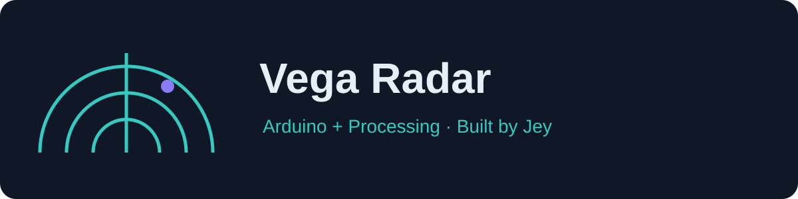

# Vega Radar

A joystick-controlled Arduino ultrasonic scanner with automatic sweeping, proximity alerts, and a live Processing display.

**Status: educational prototype.** These reorganized sketches have not yet been compiled or tested on physical hardware. This is an ultrasonic scanner, not radio-frequency radar.

The display shows targets below 40 cm; the buzzer threshold is 50 cm. These settings serve different purposes.

## Features

- Automatic 0–180° sweep and manual joystick positioning
- Joystick button toggles automatic/manual modes
- HC-SR04 distance measurement
- Active buzzer and common-cathode RGB LED feedback
- Live sector display with angle and distance readouts
- Navy, turquoise, and violet Vega theme

## Download and run

1. Use **Code → Download ZIP**, then extract it, or clone this repository.
2. Open [the Arduino sketch](firmware/vega_radar/vega_radar.ino) in Arduino IDE.
3. Select **Arduino Uno** and the correct USB port. Install **Servo** via Library Manager if needed; verify and upload.
4. Open [the Processing sketch](visualization/radar_display/radar_display.pde) in **Java mode**.
5. Set `SERIAL_PORT_NAME` to the Arduino USB port. Available ports are printed to the Processing console.
6. Close Arduino Serial Monitor before running Processing; only one application can use the port.


Starting environments: Arduino IDE 2.x and Processing 3.5.4 or 4.x. Compatibility must be verified on your installation. No Python runtime is needed.

## Hardware and wiring

| Component | Arduino Uno connection |
|---|---|
| HC-SR04 | Trig D10, Echo D11, VCC 5V, GND |
| SG90 servo | Signal D9; suitable regulated 5V supply |
| Joystick | VRx A0, SW D2, VCC 5V, GND |
| Active buzzer module | Signal D3, GND; supply per module specification |
| Common-cathode RGB LED | Red D5, green D6, blue D7, common GND |

Use appropriate resistors with discrete LEDs and check module labels/polarity. Power the servo from a suitable external 5V supply and connect its ground to Arduino ground. D7 has no PWM on Uno: the blue channel supports on/off states with this wiring.

## Controls

| Action | Behavior |
|---|---|
| Press joystick button | Toggle automatic/manual mode |
| Move joystick in manual mode | Set servo angle |
| Valid distance below 50 cm | Red LED and buzzer |
| No valid echo | Distance 0; no target plotted |

## Telemetry

9600 baud; angle in degrees and distance in centimeters.

```text
90,25
```

A newline terminates the packet. The firmware sends the measurement before advancing its commanded angle. Zero means no valid echo. 

Use firmware and displays from the same repository: the related project's packet terminator differs.

## Layout

```text
firmware/       Arduino sketches with matching folder names
visualization/  Processing sketches with matching folder names
assets/         Vega banner
docs/           Validation checklist and troubleshooting
legacy/         Original uploads retained for reference
LICENSE         Existing license
```

Start from the organized sketches. Legacy uploads may contain outdated paths, formats, or instructions.

## Troubleshooting

- **Port busy:** close Serial Monitor and other serial applications.
- **Port missing:** check the USB data cable, board connection, and OS driver.
- **No display updates:** confirm 9600 baud, port name, and the correct paired firmware.
- **Unstable readings or resets:** check shared ground, wiring, and servo power.
- **No echo:** check sensor orientation and target surface; zero is not a zero-distance object.

## Validation and limitations

See [the validation checklist](docs/VALIDATION.md). Compilation, physical wiring, and real operation still need verification. Distance accuracy depends on sensor orientation, surface material, calibration, and servo settling. Current parsers are permissive and should not be treated as a robust general-purpose telemetry interface.

## Related project

[Vega Radar Lab](https://github.com/mj0five/A-Layered-Architecture-Educational-Radar): expanded firmware organization and two display approaches.

## Contributing

Open an issue with board model, software versions, wiring, port, expected behavior, observed behavior, and a telemetry sample. Real hardware photos and reproducible fixes are welcome.

## Credits and license

Maintained by **Jey**, part of the Vega project family. 

See [LICENSE](LICENSE) for the existing terms.
